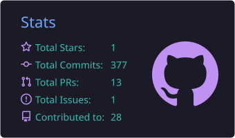
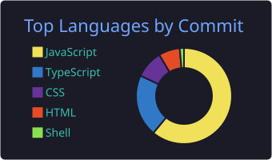
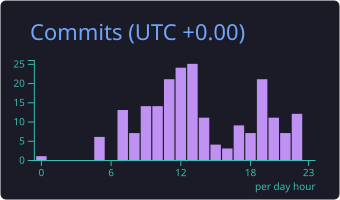
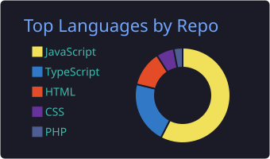

<div align="center">

# 👋 Hi, I'm Bereket

### Software Engineering Student • Front-End Focused • Building Scalable Web Apps

Building clean, performant, and user-focused digital experiences.


[](https://github.com/BereketMelese)
[](https://github.com/BereketMelese?tab=followers)

</div>

---

## 🚀 About Me

I'm a Software Engineering student focused on building maintainable, scalable applications using modern web technologies.

Recently, I've been developing full-stack applications with **React** and **Node.js** — and digging deeper into **PHP / Laravel** on the backend — focusing on reusable architecture, clean data flow, and practical problem-solving.

- 🌱 Currently learning **Cloud Engineering** & **AI Automation**
- 🔭 Building full-stack web applications end to end
- 🎯 Goal: become a high-impact software engineer
- ⚡ Fun fact: I learn best by shipping real projects

---

## ⚡ Core Stack

### Primary Technologies

<p>
  
</p>

### Languages

<p>
  
</p>

### Frontend

<p>
  
</p>

### Backend

<p>
  
</p>

### Tooling

<p>
  
</p>

---

## 🌱 Currently Exploring

| 🤖 AI Automation & LLM Integration | ☁️ Cloud Engineering | 🏗 Scalable System Design |
| :---: | :---: | :---: |
| Building agents & workflow automation | Deploying and scaling cloud-native apps | Designing systems that grow with demand |

---

## 📊 GitHub Analytics

<div align="center">
  
  
</div>

---

## 🔥 Contribution Activity

<div align="center">
  
  
</div>

---

## 🐍 Contribution Snake

<div align="center">
  <picture>
    <source media="(prefers-color-scheme: dark)" srcset="https://raw.githubusercontent.com/BereketMelese/BereketMelese/output/github-contribution-grid-snake-dark.svg" />
    
  </picture>
</div>

---

## 🎯 Current Focus

```ts
const bereket = {
  focus: ["Full-stack development", "System design"],
  stack: ["React", "Next.js", "Node.js", "Laravel", "TypeScript", "PHP"],
  learning: ["Cloud", "AI Automation"],
  goal: "Become a high-impact software engineer",
};
```

---

## 📜 Philosophy

> **Consistency beats intensity**

Ship consistently. Refactor deliberately. Keep improving.

---

<div align="center">

### 💬 "Code is read more often than it is written."

Thanks for visiting my profile! ⭐

</div>
